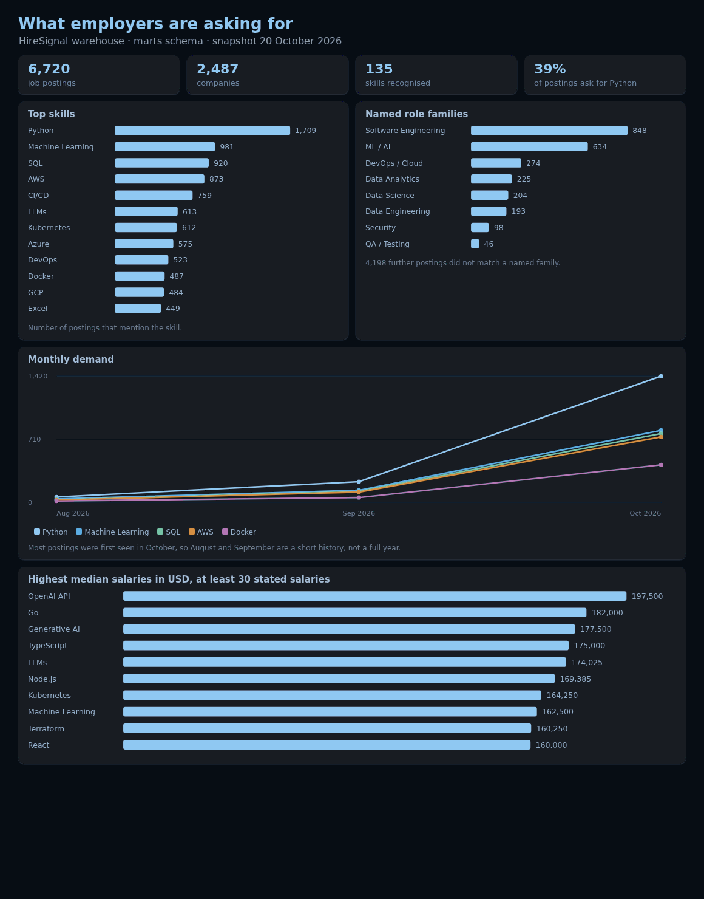
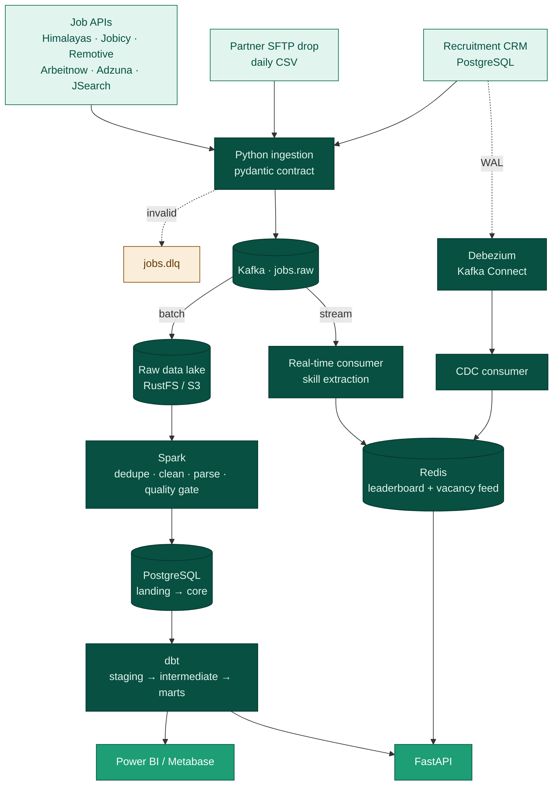

<p align="center">
  
</p>

<p align="center">
  <b>What technologies are employers actually asking for?</b><br>
  An end-to-end data engineering platform that turns thousands of noisy job postings into a clear signal.
</p>

<p align="center">
  <a href="https://github.com/Sbusiso-tech/hiresignal/actions/workflows/ci.yml"></a>
</p>

<p align="center">
  
  
  
  
  
  
  
  
  
</p>

<p align="center">
  <a href="#-the-signal">The signal</a> ·
  <a href="#%EF%B8%8F-how-it-works">How it works</a> ·
  <a href="#-quick-start">Quick start</a> ·
  <a href="#-data-collected">Data</a> ·
  <a href="#-data-model-dbt-schema-marts">Data model</a> ·
  <a href="#%EF%B8%8F-engineering-decisions">Decisions</a> ·
  <a href="#-demo-in-ten-minutes">Demo</a> ·
  <a href="#%EF%B8%8F-roadmap">Roadmap</a>
</p>

---

## 📡 The signal

Warehouse snapshot from 20 October 2026: **6,720 postings** from **2,487 companies**, with **135 skills** recognised.

| Rank | Skill            | Jobs  | Share | Demand                 |
| :--: | ---------------- | ----: | ----: | ---------------------- |
| 1    | Python           | 1,709 | 39%   | `████████████████████` |
| 2    | Machine Learning | 981   | 22%   | `███████████`          |
| 3    | SQL              | 920   | 21%   | `███████████`          |
| 4    | AWS              | 873   | 20%   | `██████████`           |
| 5    | CI/CD            | 759   | 17%   | `█████████`            |
| 6    | LLMs             | 613   | 14%   | `███████`              |
| 7    | Kubernetes       | 612   | 14%   | `███████`              |
| 8    | Azure            | 575   | 13%   | `███████`              |

### 📊 Dashboard

<p align="center">
  
</p>

<p align="center"><sub>Rendered from the live <code>marts</code> tables on 20 October 2026. Explore the same tables in Power BI (Windows) or Metabase (<code>make metabase</code>, Linux).</sub></p>

---

## 🛰️ How it works

HireSignal collects real job postings from public job APIs, a partner's daily SFTP file drop and an
operational recruitment CRM, streams them through Kafka into a data lake, transforms them with Spark,
models them with dbt in PostgreSQL, and serves the results to Power BI and a REST API, both as
twice-daily batch analytics and as real-time counts. Debezium adds change data capture on the CRM, so
a recruiter's edit reaches the API within seconds.



<sub>Orchestrated by Apache Airflow, twice daily at 06:00 and 18:00.</sub>

| Layer          | Path                                   | Freshness        | Purpose                                         |
| -------------- | -------------------------------------- | ---------------- | ----------------------------------------------- |
| **Batch**      | Kafka → lake → Spark → dbt marts       | twice daily      | complete, deduplicated, historical analytics    |
| **Speed**      | Kafka → real-time consumer → Redis     | seconds          | live skill leaderboard (`/skills/realtime`)     |
| **CDC**        | CRM WAL → Debezium → Kafka → Redis     | seconds          | what recruiters just changed (`/jobs/latest`)   |

---

## 🚀 Quick start

**Requirements:** Docker with Compose v2, `make`, about 6 GB of free RAM.
Step-by-step guides: [Linux setup](docs/Job-Market-Platform-Setup-Linux.pdf) · [Windows setup](docs/Job-Market-Platform-Setup-Windows.pdf) · [Project overview](docs/Job-Market-Platform-Project-Overview.pdf)

```bash
git clone https://github.com/Sbusiso-tech/hiresignal.git && cd hiresignal
cp .env.example .env          # optional: add Adzuna / RapidAPI keys
make up                       # Kafka, RustFS, Postgres, Redis, SFTP, lake sink, realtime consumer, API
make partner-drop             # the partner uploads today's CSV to the SFTP server
make crm-activity             # recruiters change vacancies in the CRM database
make pipeline                 # ingest -> drain to lake -> Spark -> dbt build
make top-skills               # print the signal
```

Optional extras:

```bash
make cdc       # Debezium on crm.vacancies -> Kafka -> Redis, served by /jobs/latest
make airflow   # scheduled DAG: partner drop + CRM activity + the whole pipeline
make metabase  # BI on Linux, reading the same marts as Power BI
make help      # every target with a one-line description
make down      # stop (keeps data);  make clean  # stop and wipe all volumes
```

| Service                            | URL                            | Login                     |
| ---------------------------------- | ------------------------------ | ------------------------- |
| API docs (Swagger)                 | http://localhost:8000/docs     |                           |
| Kafka UI                           | http://localhost:8081          |                           |
| RustFS console (data lake)         | http://localhost:9001          | rustfsadmin / rustfsadmin |
| Spark UI (while `make spark` runs) | http://localhost:4040          |                           |
| Airflow (`make airflow`)           | http://localhost:8080          | admin / admin             |
| Kafka Connect / Debezium (`make cdc`) | http://localhost:8083/connectors |                       |
| Metabase (`make metabase`)         | http://localhost:3000          | set up on first visit     |
| PostgreSQL warehouse               | localhost:5432                 | jobmarket / jobmarket     |
| Partner SFTP                       | sftp://localhost:2222          | partner / partner         |
| Recruitment CRM (PostgreSQL)       | localhost:5433, database `crm` | crm / crm                 |

> [!TIP]
> These are local development credentials only. Change them in `.env` before exposing anything beyond your machine.

### 🔌 API examples

```bash
curl "localhost:8000/health"
curl "localhost:8000/skills/top?limit=10"
curl "localhost:8000/skills/top?category=Data%20Engineering"
curl "localhost:8000/skills/Python/trend"                 # monthly demand for one skill
curl "localhost:8000/skills/Apache%20Spark/related"       # what to learn next
curl "localhost:8000/roles/Data%20Engineering/skills"
curl "localhost:8000/salaries/by-skill"
curl "localhost:8000/companies/top"
curl "localhost:8000/jobs?skill=dbt&remote=true"
curl "localhost:8000/skills/realtime"                     # speed layer (Redis)
curl "localhost:8000/jobs/latest"                         # CRM vacancy changes via Debezium CDC
curl "localhost:8000/pipeline/runs"                       # batch run audit log
```

---

## 📥 Data collected

Every posting is normalised to the same fields:

| Field                                                      | Notes                                                                                |
| ---------------------------------------------------------- | ------------------------------------------------------------------------------------ |
| `job_title`, `company`, `location`, `country`, `is_remote` | straight from the source                                                             |
| `salary_min/max`, `salary_currency`, `salary_period`       | structured fields, or parsed from text such as `"$90k - $105k"` or `"$45-$120/Hour"` |
| `salary_annual_*`, `salary_usd_*`                          | annualised (hour×2080, month×12…) then converted to USD in dbt                       |
| `skills`                                                   | ~150 technologies extracted from title, description and tags                         |
| `experience_years_min/max`                                 | patterns such as "3-5 years", "5+ years", "Mindestens 3 Jahre"                       |
| `seniority`                                                | intern / junior / mid / senior / lead                                                |
| `employment_type`                                          | full_time / part_time / contract / internship / temporary / unspecified              |
| `date_posted`, `first_seen_at`, `last_seen_at`             | posting date plus pipeline observation history                                       |

### Sources

| Source                                                                       | Key needed | Coverage                                                       |
| ---------------------------------------------------------------------------- | ---------- | -------------------------------------------------------------- |
| [Himalayas](https://himalayas.app/api)                                       | no         | 100k+ remote jobs, structured salaries and seniority           |
| [Jobicy](https://jobi.cy/apidocs)                                            | no         | remote tech jobs, structured salaries                          |
| [Remotive](https://remotive.com/api-documentation)                           | no         | latest remote jobs (small, 24h-delayed feed)                   |
| [Arbeitnow](https://www.arbeitnow.com/blog/job-board-api)                    | no         | Europe / Germany                                               |
| [Adzuna](https://developer.adzuna.com/)                                      | free key   | **South Africa** (`za`), UK, US… with salaries                 |
| [JSearch (RapidAPI)](https://rapidapi.com/letscrape-6bRBa3QguO5/api/jsearch) | free key   | Google for Jobs aggregate (LinkedIn, Indeed, …)                |
| Partner SFTP drop                                                            | SFTP login | daily CSV from a fictional South African recruitment agency    |
| Recruitment desk CRM                                                         | DB login   | vacancies from an operational PostgreSQL database (`crm-db`)   |

**Partner SFTP drop.** `make partner-drop` plays the partner and uploads a deterministic daily CSV to the
`sftp` container. Ingestion reads every file in `upload/exports` and moves it to `upload/archive` only
after Kafka has acknowledged all of its rows.

**Recruitment CRM.** `make crm-activity` plays the recruiters, opening, re-pricing, filling and closing
vacancies in a separate PostgreSQL database (`crm-db`, schema `crm`). The batch path reads every vacancy
changed in the last `CRM_LOOKBACK_HOURS` (default 72) through a read-only session. `make cdc` adds the
live path: Debezium tails the CRM write-ahead log and a consumer keeps the newest vacancy changes in Redis.

> [!NOTE]
> The partner drop and the CRM are simulated and their companies are fictional. Filter on
> `source not in ('partner_sftp', 'crm_postgres')` for market-only analysis. Sources without
> credentials are skipped automatically. Please respect each provider's terms: keep the `url` link
> back to the original posting and credit the source.

---

## 🧱 Data model (dbt, schema `marts`)

| Model                                          | Purpose                                                    |
| ---------------------------------------------- | ---------------------------------------------------------- |
| `fct_job_postings`                             | one row per posting (grain: `job_id`)                      |
| `dim_company`, `dim_skill`, `bridge_job_skill` | star schema for BI                                         |
| `mart_skill_demand`                            | **ranked skill demand**, share of tech jobs, median salary |
| `mart_skill_demand_monthly`                    | trend per skill per month                                  |
| `mart_skill_by_job_family`                     | top skills for Data Engineering, Data Analytics, DevOps, … |
| `mart_salary_by_skill`                         | p25 / median / p75 annual USD salary per skill             |
| `mart_skill_pairs`                             | skills requested together                                  |
| `mart_market_overview`                         | counts by family × seniority × employment type × remote    |
| `mart_top_companies`                           | top hiring companies and their top 5 skills                |

dbt layers: `staging` (typed, renamed views over `core`) → `intermediate` (`int_jobs_enriched`) → `marts`,
with a `currency_rates_to_usd` seed and custom tests for value ranges and composite uniqueness.

## ⚙️ Engineering decisions

- **Raw first, transform later.** Ingestion only maps fields onto a contract; the untouched payload is kept in the lake so any transformation can be replayed.
- **At-least-once plus idempotency.** The lake sink commits Kafka offsets only after a file is written, Spark de-duplicates on `job_id`, and the Postgres upsert only rewrites changed rows, so re-running any step is safe.
- **Files are acknowledged, not just read.** SFTP files move to the archive only after Kafka confirms every row, and uploads are written under a temporary name and renamed, so a half-written delivery is never half-loaded.
- **Operational and analytical stores stay apart.** The CRM is its own normalised OLTP database with constraints and an `updated_at` trigger, read in a read-only session over an overlapping time window.
- **Change data capture on the operational database.** Debezium reads the CRM write-ahead log (`pgoutput`) and publishes every insert, update and delete on `crm.vacancies` to Kafka. The batch extract stays the complete, replayable copy; the CDC feed is the live view.
- **Lambda architecture.** Kafka feeds both the batch path (lake → Spark → dbt) and a speed path (Redis, live within seconds).
- **Data quality at every layer.** pydantic validation with a dead-letter topic, a Spark quality gate that fails the run before loading bad data, dbt tests (unique, not null, accepted values, relationships, salary ranges) and source freshness checks.
- **Lineage and observability.** `core.pipeline_runs` records every Spark run: raw records, unique jobs, inserts, updates and status.
- **One image per runtime.** A single app image runs ingestion, consumers, Spark and the API, launched by Airflow's `DockerOperator`.
- **Checked on every push.** GitHub Actions runs `ruff`, `pytest` and `dbt parse` (dbt pinned to 1.8, the same version as the image) on `main` and on pull requests.

---

## 🎬 Demo in ten minutes

The stack is already up (`make up`).

1. **The question.** Open the dashboard above, or Metabase at http://localhost:3000. Python is in 39% of postings.
2. **Three sources.** `make partner-drop`, `make crm-activity`, then `make ingest`. Show the `jobs.raw` topic in Kafka UI at http://localhost:8081.
3. **Batch path.** `make pipeline` drains Kafka to the lake, runs Spark and builds the dbt marts. Then `make top-skills`. A second run inserts nothing for rows that did not change.
4. **Live path.** `make cdc`, `make crm-activity` again, then `curl -s localhost:8000/jobs/latest | python3 -m json.tool`. The change is in Redis before the next batch run.
5. **Schedule.** Open Airflow at http://localhost:8080 and show `job_market_pipeline`: partner drop and CRM activity, then ingest, lake, Spark, dbt.
6. **Close.** Point at the green GitHub Actions run on `main`, and at the engineering decisions above.

---

<details>
<summary><b>📁 Project layout</b></summary>

```text
src/jobmarket/
  sources/              one module per source: job APIs, partner SFTP drop, CRM
  partner_feed.py       simulated partner: daily CSV upload to the SFTP server
  crm_simulator.py      simulated recruiters: activity in the CRM database
  sftp_io.py            SFTP connection helpers (paramiko)
  models.py             RawJobEvent: the pydantic contract for the jobs.raw topic
  ingest.py             APIs + SFTP + CRM -> Kafka (with dead-letter topic)
  lake_sink.py          Kafka -> S3 raw zone (gzipped JSONL, Hive-style partitions)
  realtime.py           Kafka -> Redis skill leaderboard (speed layer)
  cdc_consumer.py       Debezium CRM change events -> Redis vacancy feed
  transform.py          cleaning rules (salary, experience, seniority, employment type)
  skills.py             skill extractor + skills_taxonomy.yml
  spark_jobs/           Spark batch job: lake -> curated Parquet -> Postgres upsert
  sql/                  warehouse DDL + idempotent upsert, CRM schema
  api/                  FastAPI service
cdc/                    Debezium connector config
dbt/                    staging -> intermediate -> marts, tests, FX seed
airflow/dags/           orchestration DAG (DockerOperator tasks)
docker/                 app, dbt, Postgres init and SFTP images
docs/                   setup guides, project overview, dashboard
tests/                  unit tests (pytest)
.github/workflows/      CI: lint, unit tests, dbt parse
```
</details>

<details>
<summary><b>📊 Power BI setup</b></summary>

1. **Get Data → PostgreSQL database**, server `localhost:5432`, database `jobmarket`, credentials from `.env`.
2. Import from schema `marts`: `fct_job_postings`, `dim_skill`, `dim_company`, `bridge_job_skill`, `mart_skill_demand`, `mart_skill_demand_monthly`, `mart_salary_by_skill`, `mart_skill_by_job_family`.
3. Relationships: `fct_job_postings[job_id]` 1→* `bridge_job_skill[job_id]`; `dim_skill[skill_key]` 1→* `bridge_job_skill[skill_key]` (cross-filter: both); `dim_company[company_key]` 1→* `fct_job_postings[company_key]`.
4. Suggested measures:

```dax
Jobs = DISTINCTCOUNT ( fct_job_postings[job_id] )
Jobs Requiring Skill = CALCULATE ( [Jobs], bridge_job_skill )
% of Jobs = DIVIDE ( [Jobs Requiring Skill], CALCULATE ( [Jobs], ALL ( dim_skill ) ) )
Median Salary (USD) = MEDIAN ( fct_job_postings[salary_usd_mid] )
Remote Share = DIVIDE ( CALCULATE ( [Jobs], fct_job_postings[is_remote] = TRUE () ), [Jobs] )
```

Suggested pages:
- **Skill demand:** bar chart of the top 20 skills with a skill-category slicer.
- **Trends:** line chart from `mart_skill_demand_monthly`.
- **Salaries:** p25, median and p75 from `mart_salary_by_skill`.
- **Roles:** matrix of job family by skill.
- **Companies:** table from `mart_top_companies`.

**Metabase (Linux):** `make metabase`, open http://localhost:3000, connect to host `postgres`, port `5432`, database `jobmarket`, schema `marts`.
</details>

<details>
<summary><b>🎓 Curriculum mapping (WeThinkCode_ Data Engineering elective)</b></summary>

| Week | Topic                                                    | Where in HireSignal                                                          |
| ---- | -------------------------------------------------------- | ---------------------------------------------------------------------------- |
| 1    | ETL, Linux/Bash, Python + Pandas                         | `ingest.py` → `transform.py` → load; Makefile/Bash automation                |
| 2    | Storage, file formats, distributed FS, CAP, Docker       | gzipped JSONL raw zone + Parquet curated zone on RustFS; fully containerised |
| 3    | SQL, ERDs, normalisation, ACID, PostgreSQL, NoSQL        | OLTP CRM vs OLAP warehouse; star schema; Redis key-value store               |
| 4    | Lakes vs warehouses, ETL vs ELT, REST ingestion          | six REST APIs + SFTP; RustFS lake + Postgres warehouse; ELT with dbt         |
| 5    | Batch vs stream, Spark, Kafka, Airflow                   | Spark batch job, Kafka streaming consumers, Debezium CDC, Airflow DAG        |
| 6    | Data governance and quality                              | contracts, DLQ, quality gate, dbt tests and freshness, run audit table, CI   |
| 7–8  | Capstone                                                 | APIs + SFTP + CRM, Kafka, Spark, Airflow, dbt, FastAPI, Redis, Debezium CDC  |
| 9    | Demo and defence                                         | architecture diagram, engineering decisions, live API + dashboard, demo above |
</details>

<details>
<summary><b>🛠️ Running locally without Docker</b></summary>

```bash
python3 -m venv .venv && .venv/bin/pip install -e ".[dev,pipeline,api]"
.venv/bin/ruff check src tests airflow
.venv/bin/pytest
.venv/bin/python -m jobmarket.ingest --dry-run data/sample.jsonl   # hit the real APIs, no Kafka
```
</details>

---

## 🗺️ Roadmap

- [x] Apache Airflow DAG to schedule the whole pipeline
- [x] SFTP source: a partner's daily CSV export of job postings
- [x] Operational PostgreSQL source: the recruitment desk's CRM
- [x] Debezium CDC on the CRM: stream vacancy changes into Kafka and Redis
- [x] GitHub Actions CI: lint, unit tests and dbt parse
- [x] Dashboard screenshot, Metabase and setup guides (Linux, Windows, overview)
- [ ] Hosted HireSignal web dashboard

## 💡 Ideas to extend

- Use an FX API instead of the static `currency_rates_to_usd` seed.
- Classify skills with an LLM or NER model and compare against the dictionary approach.
- Store the curated zone as Delta Lake or Iceberg tables and query it with Trino.
- Deploy to AWS (MSK, S3, EMR, RDS and MWAA) using Terraform.

<p align="center"><sub>Built by <a href="https://github.com/Sbusiso-tech">Sbusiso-tech</a> · HireSignal 📡</sub></p>

WTC-AJPLDQS3